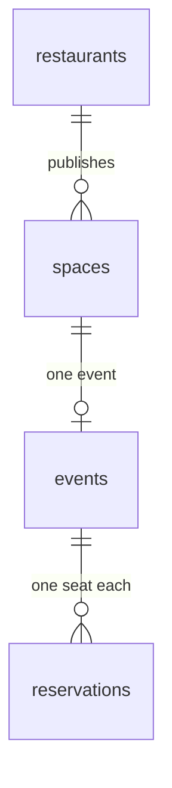

# Data model

Source of truth for the V0 database. `supabase/schema.sql` implements this document.

V0 has no accounts and no payments. People are name and email columns. A space row is one dated time slot: publishing Wednesday and Thursday creates two rows.



UUID primary keys. Foreign keys use `on delete cascade`.

## Tables

### restaurants

| Column | Constraint |
|---|---|
| `id` | `uuid` primary key, `default gen_random_uuid()` |
| `name` | `text` not null |
| `location` | `text` not null |
| `created_at` | `timestamptz` not null, `default now()` |

Unique index on `(lower(trim(name)), lower(trim(location)))`.

### spaces

| Column | Constraint |
|---|---|
| `id` | `uuid` primary key, `default gen_random_uuid()` |
| `restaurant_id` | `uuid` not null, references `restaurants` |
| `label` | `text` not null, e.g. "Table A" |
| `starts_at` | `timestamptz` not null |
| `ends_at` | `timestamptz` not null, `ends_at > starts_at` |
| `capacity` | `int` not null, `check (capacity > 0)` |
| `description` | `text`, nullable |
| `price_info` | `text`, nullable. Display copy only |
| `status` | `text` not null, `default 'available'`, `check (status in ('available', 'booked'))` |

`label` separates two spaces that share a restaurant and a time window. Only `create_event_for_space` sets `status` to `booked`.

### events

| Column | Constraint |
|---|---|
| `id` | `uuid` primary key, `default gen_random_uuid()` |
| `space_id` | `uuid` not null, unique, references `spaces` |
| `title` | `text` not null |
| `description` | `text`, nullable |
| `capacity` | `int` not null, `check (capacity > 0)` |
| `organizer_name` | `text` not null |
| `organizer_email` | `text` not null, stored trimmed and lowercased |
| `created_at` | `timestamptz` not null, `default now()` |

`space_id` unique means one event per slot. `capacity` is how many spots the organizer offers. The function also rejects a value above `spaces.capacity`.

### reservations

| Column | Constraint |
|---|---|
| `id` | `uuid` primary key, `default gen_random_uuid()` |
| `event_id` | `uuid` not null, references `events` |
| `name` | `text` not null |
| `email` | `text` not null, stored trimmed and lowercased |
| `confirmation_code` | `text` not null, unique. 8-character hex, generated in `reserve_seat` |
| `created_at` | `timestamptz` not null, `default now()` |

Unique on `(event_id, email)`. Each row is one seat. Names, title, label, emails, and confirmation code are `NOT NULL`, so those unique constraints block duplicates. Postgres treats nulls as distinct.

## Publish

Find-or-create the restaurant on normalized name and location, then insert the space as `available`. The publish form prefills name and location from the seed restaurant so the two demo spaces share one row. There is no owner login, so the restaurant page lists every space.

## Functions

Both functions run in one transaction. Server actions call them with the service role. V0 has no row-level security.

### `create_event_for_space(space_id, title, description, capacity, organizer_name, organizer_email)`

1. `select … for update` locks the space row.
2. Fail with `SPACE_NOT_FOUND` if the space is missing, `SPACE_NOT_AVAILABLE` if `status` is not `available`, or `CAPACITY_INVALID` if `capacity` is under 1 or greater than the space's capacity.
3. Insert the event, set the space to `booked`, and return the event.

The function does not insert a reservation for the organizer.

### `reserve_seat(event_id, name, email)`

1. `select … for update` locks the event row, and trims and lowercases the email.
2. Fail with `EVENT_NOT_FOUND` if the event is missing, and with `EVENT_FULL` if the reservation count is at or above `events.capacity`.
3. Insert the reservation. The unique pair raises `ALREADY_RESERVED`. Generate an 8-character hex `confirmation_code` and return it.

## Views

### `available_spaces`

`status = 'available'` and `starts_at > now()`, with restaurant name, location, label, times, capacity, description, and price info. Powers `/spaces`.

### `events_with_availability`

Event fields, space time, label, and price info, restaurant name and location, and:

```text
seats_left = events.capacity - count(reservations)
```

Sold-out rows stay in the view. The events list filters to upcoming times. Powers `/events` and the landing page.

The organizer has no reservation row, so a capacity-10 event shows 10 spots until the first join, then 9.

### `spaces_with_booking`

Every space, including past ones. Booked rows include the event title, organizer name, and seats taken. Powers `/restaurant`.

## Time

Store UTC in `timestamptz`. Display in `America/Los_Angeles`. The publish action interprets the form date and clock times in that zone. There is no separate date column.

## Seed and reset

`supabase/seed.sql` inserts three Seattle restaurants: Il Nido, Harbor & Pine, and Saffron Table.

- Il Nido gets no spaces, so the demo's first step (publishing two spaces) starts clean.
- Harbor & Pine and Saffron Table get sample spaces dated relative to today in Seattle. Two of them are booked through `create_event_for_space`, and their reservations go through `reserve_seat`. One event is sold out.
- Re-running is safe. Restaurants are skipped on conflict, and sample spaces are added only when those two restaurants have none.

Reset truncates `spaces`, `events`, and `reservations` and leaves `restaurants` in place. Run the seed again afterwards to restore the sample data.

## Left out of V0

No `users` table, party size, payments, cancellations, waitlists, or recurring slots. `price_info` is text the restaurant typed in, not a charge.
